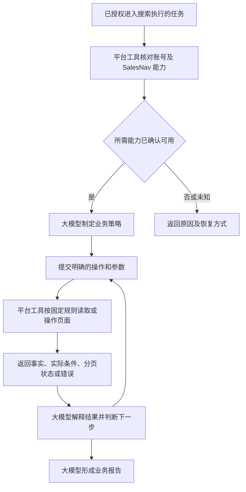

# Sales Navigator 独立插件需求文档

版本：0.8｜日期：2026-10-20｜状态：实现与验收中；完整门槛及逐项证据见 E2E_TEST_PLAN.md 和 ACCEPTANCE.md。

依据：用户提供的四张业务需求截图、本轮对话，以及 本地页面探索记录 和 （真实页面证据仅保留在本地，不随仓库分发）。截图里的搜索建议作为需求参考，不能视为已验证的平台行为。

## 0. 设计方法：从真实需求推导可复用能力

本插件以第 1 节的真实业务需求为起点，先识别完成任务所需的动作，再抽象成可复用平台能力。行业、地区、规模、联系人画像和工作顺序由每次任务决定。首版优先级由此案例暴露的能力缺口确定，不要求构建全部 Sales Navigator 功能。

需求变更分为三类：值变化（如国家和规模）只改变调用参数；策略变化（如先找人员再找公司）只改变模型的调用组合；能力变化（如需要当前未支持的筛选或页面）才需要开发适配器。前两类不应要求修改插件代码，也不应要求改写一套固定业务规则。

### 业务判断与平台操作分离

**统一要求：凡涉及平台的读取、导航、输入、选择、点击、提交、翻页及状态确认，都必须封装为确定性能力。** 正式业务运行时，大模型只调用已定义工具并提供参数，不直接编写页面脚本、选择 DOM、猜测 URL/请求或临时决定点击步骤。这一要求覆盖全部平台操作，不只覆盖搜索。

“全部确定性”是执行边界，不表示首版已经实现平台全部功能。未封装或未验证的动作返回 unsupported，进入后续适配开发；不能退回让模型自由操作浏览器。探索和开发阶段允许使用 OpenCLI 查清页面行为，但探索手段不作为正式插件的运行兜底。

用户已确认：业务逻辑和业务判断由大模型完成；平台层提供确定性的页面读取和操作能力。Skill 指导模型使用工具，不把行业策略写进执行代码。

| 归属 | 负责 | 不负责 |
|---|---|---|
| 业务层：大模型 + Skill | 理解目标、提出澄清、选择关键词/筛选值、安排搜索顺序、判断匹配、决定下一步、撰写报告 | 自行猜平台 ID、声称未执行的条件已生效 |
| 平台层：工具 / 适配器 | 明确页面、定位控件、校验参数、执行动作、读取结构化事实、分页、状态和错误处理 | 解释“小型国际企业”、选择赛道、放宽条件、评价企业价值 |
| 通用执行支撑 | 账号隔离、本地预算、进度、精确去重、文件序列化 | 用本地计数冒充平台余额、按业务相关性删除结果 |

平台操作的确定性指：页面状态、参数和支持版本相同，操作规则固定且可测试；不保证动态网站每次返回相同内容。页面变更或控件不匹配时返回明确错误，由适配器维护流程修复，不能在正式执行中交给模型临时猜测点击。

医疗科技、东南亚、规模主补轮、公司优先等都是本案例的业务策略，不是插件平台层的默认规则。其他业务可以用同一组工具，从人员搜索开始，或只读取指定公司的详情。

## 1. 用户需要完成什么任务（业务案例）

用户希望从大量公司中找到一批小型国际医疗科技企业：全球人数约 200 人，在东南亚有实际业务及团队，区域团队规模理想为几十至约 100 人。重点关注牙科、眼科/视觉医疗、听力医疗，补充体外诊断及生命科学试剂企业；业务以临床器械、设备、耗材或试剂为主，排除纯消费护理产品及普通眼镜零售。

需要的最终交付是可继续研究和开展业务的公司名单，说明每家公司为什么匹配、东南亚存在的证据、哪些条件仍未核实；需要时进一步找到相关人员。最终用途可能是商业拓展、招聘或市场研究，目前未确认，不应将任何一种写成既定用途。

| 需求维度 | 本次目标 | 对本次目标的理解（不是平台默认规则） |
|---|---|---|
| 公司规模 | 全球约 200 人 | 需要把近似人数转换为可用规模区间；采用哪个区间及是否扩展，由模型结合本次目标决定 |
| 国际属性 | small international medtech | 需要经营区域或组织证据，不能仅凭 international 关键词认定 |
| 区域 | 新加坡、泰国、马来西亚、印度尼西亚、越南、菲律宾 | 人员所在地、办公室或业务覆盖，与全球总部所在地分别记录 |
| 区域规模 | 东南亚几十至约 100 人 | 作为待核验目标；不能用搜索命中数直接估算实际团队人数 |
| 主赛道 | Dental、Ophthalmic / Vision、Hearing / Audiology | 可按赛道分别检索；分组和用词由模型制定 |
| 补充赛道 | IVD、life science reagents | 本次属于补充方向；是否单独查询由模型决定 |
| 排除范围 | 纯消费护理、牙膏、普通眼镜零售等 | 结合简介判断；混合业务企业应单列，不因出现一个词直接删除 |
| 企业角色 | 偏向“小厂” | 制造商优先是设计假设；经销商、服务机构、子公司分别标注，是否排除待用户确认 |
| 联系人 | 未指定岗位 | 尚不能确定职位筛选；模型依据用户目标决定是否需要联系人 |

## 2. 产品定位与成功标准

独立插件交付通用 Sales Navigator 平台工具及配套 Skill，复用 OpenCLI 和用户已登录 Chrome。大模型通过 Skill 理解工具语义，按用户任务组合调用；平台工具不接收模糊业务目标后自行规划。

平台层成功标准：操作契约明确、参数不被擅自修改、实际生效条件可核对、结果事实可追溯、错误可区分。业务层成功标准：模型能用这些能力完成有证据的目标名单，并清楚解释推断和未知。两层独立验收。

## 3. 两层协作流程

模型负责决定何时找公司、何时找人员、何时补充详情。工具可以封装一个完整的平台操作，例如“设置指定筛选并搜索第一页”，不必让模型逐次点按钮。工具内部读取状态、等待就绪、固定次数重试和按明确上限翻页属于技术执行规则。

模型不能绕过工具的身份校验与预算限制。工具返回空结果或锁定条件后，由模型解释并在用户授权范围内提出或执行新的明确查询；工具本身不自动放宽。

## 4. 从业务需求到通用能力的追溯

| 本次业务需求 | 完成需求所需的动作 | 推导出的通用平台能力 | 本次可选用法 | 需求变化时 |
|---|---|---|---|---|
| 找医疗科技企业 | 按词和行业检索，读取公司信息 | 公司搜索、行业候选、公司详情 | 搜索眼科产品词并核对简介 | 换软件行业，只换词及行业实体 |
| 全球约 200 人 | 查看规模选项并应用选定范围 | 公司规模选项读取、规模筛选 | 模型可能选 51–200，也可能需另一组区间覆盖近似值 | 换为大型企业，只换区间 |
| 东南亚有团队 | 在公司范围内查指定地区人员，读任职信息 | 当前公司筛选、人员地区筛选、人员详情 | 选择本次相关国家 | 换欧洲，解析新地区后使用同一工具 |
| 小型国际企业 | 读取简介、总部及相关人员事实 | 公司详情、公司/人员关联字段 | 模型判断跨区域经营的证据强度 | 改为本土企业，由模型使用新判据 |
| 排除消费护理 | 查看产品和经营描述 | 公司详情原文和来源 | 模型判断纯消费或混合业务 | 换排除条件，不改详情读取代码 |
| 区域团队几十至 100 人 | 查找可用人数证据，辨别口径 | 读取页面现有字段、缺失状态和来源 | 若无对应区域人数资料，模型标记未核实 | 不新增猜测人数的计算规则 |
| 需要进一步找到人 | 按公司/地区/岗位找人员 | 人员搜索、职位/职能/职级候选与筛选 | 用户给出岗位后选择条件 | 可直接从人员搜索开始，无需先查公司 |
| 交付可核验名单 | 读取多页、关联来源、整理输出 | 分页、精确实体标识、来源、导出 | 模型组织公司名单及匹配理由 | 输出可变成人员名单、单家公司研究等 |

能力必须保留平台字段语义：总部地点、人员地点、公司总规模不是同一概念；搜索命中数不是实际团队人数。模型负责把用户语言映射到这些能力，平台负责忠实执行映射后的参数。

上述需求覆盖核心搜索和资料读取；它没有证明必须开发全部 48 个筛选器，也没有证明存在可直接返回“国际属性”或“东南亚人数”的平台接口。

## 5. 平台能力规格

以下均为拟议能力，尚未实现。具体页面路径和请求映射需以现场验证为准。

| 能力 | 输入 | 固定读取/操作 | 输出 | 优先级 |
|---|---|---|---|---|
| account-check | 指定 profile、期望身份 | 核对连接和 LinkedIn 身份，检查 SalesNav 入口及公司/人员搜索页 | 账号能力状态、证据、原因及下一步 | P0，业务查询前置 |
| capabilities | profile、人员/公司类型 | 读取筛选面板，结合适配器已验证能力目录 | 字段类型、选项来源、锁定状态、支持等级 | P0 |
| filter-options | 搜索类型、字段、候选查询词 | 打开对应筛选器，读取静态选项或输入查询词读取候选 | 原始 label、平台 ID（若可得）、来源 | P0 |
| account-search | 关键词、明确筛选、获取上限 | 打开公司搜索，校验并设置全部条件，确认生效，读取结果 | 公司事实、实际条件、分页状态 | P0 |
| lead-search | 关键词、明确筛选、获取上限 | 打开人员搜索，校验并设置全部条件，确认生效，读取结果 | 人员事实、实际条件、分页状态 | P0 |
| account-read | 公司 ID 或规范 URL | 打开已验证的公司详情页，读取已定义区域 | 公司字段、原文摘录、来源；缺失字段状态 | P0，待探索 |
| lead-read | 人员 ID 或规范 URL | 打开已验证的人员详情页，读取已定义区域 | 任职等资料事实、来源；缺失字段状态 | P0，待探索 |
| search-page | 查询上下文、分页位置、上限 | 验证账号和查询指纹一致，执行下一页并读取 | 当前页、下一页状态、截断原因 | P0 |
| export | 已提供的数据、格式、路径 | 确定性序列化，本地写文件 | 文件路径、行数、导出状态 | P0 |

P0 公司筛选：关键词、公司规模、行业、总部地区。P0 人员筛选：关键词、当前公司、人员地区、职位、职能、职级。收入、增长、部门人数、经历、动态等为 P1，逐项验证后开放。完整页面字段清单引用探索文档，不等于全部已支持。

详情页尚未完成探索，是平台能力开发的前置工作；不能把搜索摘要当成完整详情。官网检索属于其他工具能力，由模型按需组合，不隐式嵌入 SalesNav 工具。

### 5.0 平台操作覆盖清单

| 操作范围 | 必须封装的行为 | 实施边界 |
|---|---|---|
| 账号和会话 | 列出连接、绑定指定 Profile、读取站内身份、检查访问权限、识别会话失效 | P0；登录/验证码要求用户处理，工具负责检测和报告 |
| 导航 | 打开已定义入口、搜索页和详情页，验证目标实体及就绪状态 | 工具内部固定导航；不暴露任意 URL 执行入口 |
| 筛选发现 | 展开筛选面板、读取字段和锁定状态、读取静态选项、查询动态候选 | 页面可见与适配器可执行分别返回 |
| 条件设置 | 文本输入、实体选择、枚举多选、包含/排除、范围、开关、清除和状态回读 | 所有支持的控件类型有固定实现；具体字段逐项验收 |
| 搜索执行 | 建立干净条件、提交或等待自动刷新、识别加载/空结果/失败、读取实际条件 | 不依据业务目标自行改词或增删筛选 |
| 结果读取 | 读取公司/人员卡片、平台总数、当前页、下一页状态 | 固定字段映射，缺失与读取失败分开 |
| 详情读取 | 打开指定实体、展开已定义信息区域、读取字段和来源 | 新区域必须先适配，不能自由点击探索 |
| 分页与恢复 | 下一页、明确上限的多页读取、恢复原查询、验证账号与查询一致 | 技术循环可在工具内部执行，不能自动换查询策略 |
| 异常处理 | 超时、弹层阻挡、未登录、验证、权限不足、限流、页面结构变化 | 已知可处理状态采用固定规则；未知状态停止并返回错误 |
| 保存与外部写入 | 保存搜索/线索、取消保存、消息、CRM 等未来操作 | 当前不在首版范围；开发时同样须有明确输入、授权、后置确认和重试规则 |

OpenCLI 是执行依赖，业务 Skill 使用插件定义的能力接口。工具封装可以覆盖多个页面步骤；无需把每次点击暴露成模型工具。只要账号、输入、页面状态与适配器版本确定，其操作路径和成功条件就应明确。

### 5.1 每项操作的实现规格

每个适配器必须记录：能力名称与版本、参数 schema、只读/外部写属性、入口页面、前置状态、语义定位、动作顺序、就绪条件、成功后置条件、字段抽取规则、分页规则、超时/重试上限、错误码和证据样例。

执行按已定义状态转移：检查前置 → 执行动作 → 验证后置 → 返回结构化结果。失败时返回失败阶段、动作是否已派发、当前观察状态和恢复要求。读取失败不能被包装为字段为空；写操作结果未知时不得盲目重试。具体状态分支由适配器实现和测试，大模型只解释结果、决定下一次明确调用。无结果是有效状态；页面未加载完不是无结果。

搜索操作固定顺序：核对身份 → 校验参数和能力 → 建立已知筛选状态 → 应用明确参数 → 读取实际条件并比较 → 执行/等待搜索 → 抽取结果。保留所需前后状态；不把上一次页面残留条件带入新查询。任一请求条件无法应用时返回失败或部分结果状态，不能静默忽略。

候选解析只返回真实候选；只有用户指定 ID 或唯一精确匹配才可确定性选中。语义相近候选由模型/用户选择，再向搜索工具提交明确实体。显示名称、DOM option value 与请求 ID 分开记录，未验证的映射不投入执行。

### 5.2 平台输入输出契约

平台输入包括：profile、expected_identity、search_type、keywords、filters、limit、分页上下文、本地 request_budget。filters 包括真实字段、已解析实体/枚举、经验证的 include/exclude 或范围表达。不传入 objective、preferred、行业目标或“符合客户需求”等业务概念。

平台输出包括：

- 操作标识、适配器版本、账号核对结果、采集时间、来源页面。
- requested_filters、applied_filters 及差异；默认技术参数也明确列出。
- 页面实际字段与短摘录，保留原始值、规范值和缺失原因；不生成业务推断。
- 平台展示总数（若可得）、实际读取数、精确去重数、分页/截断状态。
- 执行成功、部分完成或失败；结构化错误、是否派发动作及可恢复状态。

公司和人员 ID、规范 URL 可用于精确去重；母子公司合并、同名公司推断、企业角色分类均交给模型。平台直接提供的行业或企业属性可以原样返回，但必须标明为平台字段。

### 5.3 技术边界

平台层不内置关键词扩展、无结果改词、规模放宽、国家补充、公司排序评分或账号自动切换。重试只能针对同一操作和参数，并遵守固定上限；出现验证、限流时停止。

不提供自主完成业务的确定性 `run` 命令。若后续需要批处理，只接受模型生成的明确操作列表，按列表执行；不在代码中自行选择下一步业务动作。

首版不包含消息、加好友、保存线索、CRM 写入和订阅修改。后续外部写能力单独设计输入与授权边界。

## 6. Skill 如何支持变化的业务需求

Skill 为大模型提供工具说明、平台字段语义、证据规则及可选任务范例。它指导模型根据当前任务选择动作，而非规定某个行业必须使用哪些关键词、国家、规模或步骤。

Skill 不提供直接使用 browser click / eval 等原始工具绕过适配器的执行流程。Skill 的稳定内容包括：能力发现、输入准备、实体消歧、事实与推断区分、失败结果解读、来源引用。易变内容来自用户当前任务，包括业务画像、筛选值、检索顺序、扩展策略和输出列。案例与工具使用说明分开放置，案例不得作为隐含默认值。

| 大模型职责 | 业务层保存的信息 | 工具调用结果的使用 |
|---|---|---|
| 理解需求 | objective、硬条件、偏好、待核验项 | 识别哪些条件可由平台筛选，哪些需读资料判断 |
| 制定策略 | 关键词组、顺序、拟使用字段及原因 | 依据 capabilities 选择可执行操作 |
| 处理歧义 | 候选选择和理由 | 从 filter-options 返回值选定真实实体 |
| 编排检索 | 公司/人员/详情查询计划 | 根据结果和缺口决定下一次调用 |
| 匹配判断 | supported / contradicted / unknown、理由 | 引用工具事实，不把推断改写成原始字段 |
| 调整策略 | 新查询及调整原因 | 在授权范围内提交新参数，不覆盖上一轮记录 |
| 形成报告 | 业务分类、区域证据、缺口、结论 | 关联每个结论与来源，交给 export 序列化 |

业务报告与平台原始结果分开保存，通过操作 ID / 来源引用关联。业务报告可包含制造商/经销商判断、国际属性、区域存在、匹配程度；每项标明直接事实、模型推断或未知。导出工具不自行撰写这些判断。

已授权任务无需重复确认每一步；实质改变硬条件或无法确定账号时向用户澄清。未知区域人数不能用人员命中数补齐，未知硬条件不能判为全部符合。

## 7. 用变化的需求检验设计

### 7.1 原始医疗科技需求的一种执行示例

模型可以选择先按牙科、眼科、听力、IVD 分组找公司，再在候选公司内检索相关国家的人员；也可以利用用户提供的公司清单直接查人员。51–200、11–50 或其他区间的选择，应说明与用户规模目标的关系。示例不是标准步骤，也不是端到端验收唯一正确的调用序列。

工具只接收明确查询，返回原始结果。模型根据简介、产品及人员证据判断匹配，并把未能核实的国际属性、区域人数等列为缺口。若未限制总部，即不额外加入总部筛选；若用户明确只要总部在当地的企业，则按新要求设置。

示例交付行（虚构，仅展示事实与判断的区别）：

| 公司 | 平台返回事实 | 模型判断 | 未核实项 |
|---|---|---|---|
| 示例眼科设备公司 A | 规模区间 51–200；有新加坡任职人员；正式输出附来源 | 有区域人员线索，可继续研究 | 是否制造商、国际经营范围、区域人数 |

### 7.2 无需改代码的变化验收

| 新需求（测试场景，不是新增用户任务） | 模型改变什么 | 复用什么能力 | 不允许发生 |
|---|---|---|---|
| 找欧洲大型软件企业 | 行业、地区、规模、检索策略 | 候选读取、公司/人员搜索、详情 | 自动残留医疗词或东南亚国家 |
| 找指定公司在新加坡的技术负责人 | 从人员搜索开始，选择岗位条件 | 当前公司、地区、职能/职位/职级筛选 | 强制先跑完整公司发现流程 |
| 研究用户给出的三家公司 | 直接读取详情，按缺口补查 | 公司详情、按公司检索人员 | 强制执行关键词搜索或规模筛选 |
| 将目标从制造商改为经销商 | 改变资料解读和匹配判据 | 同一详情读取与搜索工具 | 适配器自动剔除经销商 |
| 本轮从 51–200 改为其他受支持区间 | 提交新查询值 | 同一规模筛选能力 | 更新代码中的默认规模或修改行业模板才能执行 |

若用户需要平台未支持的筛选，工具应明确报告能力缺口；模型不能通过编造参数假装满足。新增能力进入独立探索和开发流程。

## 8. 账号、额度和异常行为

### 8.1 第一关：当前账号是否具备 Sales Navigator 能力

用户已授权进入搜索执行阶段后，任何业务搜索前首先执行 `account-check`。Align 对齐阶段不执行此检查。这是跨业务通用的平台前置检查，不属于大模型可自由选择的业务策略。用户描述需求可以先被接收，但能力未确认时不继续执行依赖它的查询。

固定检查步骤：

1. 读取已连接的 Chrome Profile，定位用户指定账号；多个候选且无法唯一定位时让用户选择，不默认使用第一个。
2. 读取 LinkedIn 当前登录身份，与期望身份核对；Chrome Profile 名称仅作为线索，不能替代站内身份。
3. 打开已验证的 Sales Navigator 入口，等待明确就绪状态，识别工作台、登录/验证、订阅引导或错误页面。
4. 分别检查公司搜索和人员搜索页面能否就绪并读取筛选控件；记录可访问范围及锁定字段。只有入口可见不足以证明搜索可用。
5. 返回结构化判定及证据；若实际执行走独立请求适配器，其可执行性另行验证，不能由页面可达推断。业务操作仍需检查自己的前置条件。

| 状态 | 判定依据 | 行为 |
|---|---|---|
| available | 指定身份一致，相关 SalesNav 页面已就绪且所需控件可用 | 放行已确认范围内的操作；不代表所有套餐功能可用 |
| unavailable | 身份已确认，页面有明确、适用当前账号的无权限或要求订阅提示 | 停止对应操作，说明限制；不自动升级或切换账号 |
| unknown | Profile 未连接、身份不明、登录失效、验证、超时、空页面、泛化重定向或请求失败等 | 停止依赖操作，报告可恢复原因；不判定未订阅 |

返回字段：profile、observed_identity、identity_match、salesnav_access、account_search_access、lead_search_access、adapter_execution_status、restricted_features、checked_at、evidence、reason、next_action。各能力独立记录 available / unavailable / unknown；适配器未实测时为 unknown。字段命名是拟议契约。

该检查回答“这个账号现在可使用哪些 SalesNav 功能”，套餐名称可另行读取；不要求先识别准确套餐才允许使用已验证能力，也不从普通 Premium 标识推断 SalesNav 权限。一次 403、订阅页重定向或加载失败不足以独立证明没有订阅。

检查结果绑定当前 Profile、站内身份和会话。切换身份、重新连接、会话失效或出现访问异常后必须重检；历史成功记录不能永久放行。部分能力可用时仅放行对应能力，例如人员搜索已确认而公司搜索未知时，不声称两者都可用。

执行效率补充：完整检查仍为任务第一关。可选短期诊断快照最长五分钟，绑定版本、Profile、自有资料 URL 和守护进程/扩展连接代次；每次操作重新核对连接代次与自有 URL，并核验实际目标页。快照不能当作永久授权，不能升级 unknown 能力，也不能把缓存套餐/余额标成最新读取。重新连接、过期、身份变化、目标拒绝访问或执行异常时失效并重检。此优化减少重复读取套餐和两类搜索页，不改变账号隔离和目标后置验证要求。

### 8.2 额度与执行异常

订阅名称、功能可用性、套餐标称配额、当前平台剩余额度、本地执行预算分别存储。没有官方余额证据则为 unknown；不能把本地计数当成平台余额，不能因 Premium 标记就认定有 SalesNav。首版没有发送消息，因此 InMail 余额不应阻塞只读搜索。

| 异常 | 产品行为 |
|---|---|
| Profile 未连接/身份不符 | 停止，提示选定账号的连接问题；不回退其他账号 |
| 需要登录/验证 | 停止依赖操作，保留任务；用户处理后重新校验 |
| 筛选器锁定 | 解释具体字段不可用；当前操作失败，不自动删除条件继续；模型判断业务影响 |
| 实体歧义/不支持的条件 | 返回候选或明确错误；不能伪装已执行 |
| 页面加载中/窗口不可见 | 区分等待超时与点击未派发；读取状态后再决定恢复 |
| HTTP 403 | 标为访问失败并保留脱敏诊断；不能直接推断订阅失效 |
| 限流/平台限制 | 停止并记录恢复条件，不自动更换账号规避 |
| 结果为空 | 平台返回空结果及实际条件；大模型决定是否提出新的检索策略 |
| 预算耗尽/分页失败 | 返回部分结果和未完成部分，禁止标成完整名单 |

日志不保存 Cookie、令牌或完整认证头。任务与账号绑定，恢复时检查身份变化。仅保存本任务所需资料；输出位置和删除方式在用户指南中说明。

## 9. 分层验收标准

执行级测试设计见 [E2E_TEST_PLAN.md](./E2E_TEST_PLAN.md)，已获准按架构审查修订后分批开发。当前开发范围为独立 SalesNav 插件，第 12 节衔接保留为后续设计；不修改 Align 或 Sourcing。

平台测试不依赖大模型判断相关性，业务验收不替代平台动作验证。

| 编号 | 场景 | 通过条件 |
|---|---|---|
| A01 | 两个 Chrome Profile 同时连接 | 指定身份正确，错误 Profile 不发起业务查询 |
| A01b | 入口可达但搜索页未就绪 | 搜索能力为 unknown，不以工作台出现为依据放行业务查询 |
| A01c | 当前账号明确无访问权限 | 对应能力为 unavailable，停止操作，不自动切号或升级 |
| A01d | 连接/登录/加载失败及泛化重定向 | 判为 unknown 并说明原因，不误报未订阅 |
| A01e | 检查后账号或会话变化 | 原检查结果失效，重新核对后才执行 |
| A02 | 套餐名称或余额不可读 | 显示 unknown，已验证搜索能力仍可独立使用 |
| A03 | 每个 P0 筛选器 | 选中值与成功请求/页面结果条件一致；多选与清除有真实验收 |
| A04 | 锁定或无法解析的硬条件 | 明确失败，不输出声称符合条件的结果 |
| A05（业务） | 欧美总部且东南亚有人任职的测试公司 | 当用户要求区域业务而未限制总部时，模型不把总部地区当成等价条件 |
| A06 | 多组关键词、跨页重复公司 | 合并后唯一实体稳定，保留多个命中来源 |
| A07（业务） | 区域团队人数无来源 | 输出 unknown，不使用人员命中数代替 |
| A08 | 正常分页/上限/中断恢复 | 已读数、截断状态准确；恢复不串账号、不重复累计 |
| A09 | 403、加载超时、不可见窗口、限流 | 错误分类可区分，无误判套餐、无限重试或隐式换号 |
| A10（业务） | 医疗科技端到端任务 | 检索计划与当前目标一致，已执行条件、结果证据和未满足要求可追溯；不要求固定分组或固定顺序 |
| A11 | 导出 | Markdown / CSV / JSON 一致；中文和引号正确，CSV 防公式注入，无认证信息 |
| A13 | 平台动作覆盖 | 每一条业务执行路径中的读取和交互均对应已注册能力及已定义内部步骤，无临时浏览器动作 |
| A14 | 未实现字段或页面结构变化 | 返回 unsupported / page_changed 等明确错误，不让模型猜控件、编脚本或忽略条件继续 |
| A15 | 操作后置确认失败 | 不报告成功；返回动作派发状态与失败阶段，按固定恢复规则处理 |
| A12 | 安装与首次使用 | 候选包在声明支持的宿主完成安装、诊断和一次实际业务任务；不能只以 Skill 可见为通过 |

增加平台隔离验收：同一明确参数不因业务背景不同而自动增删筛选；空结果不自动扩展；候选歧义不猜 ID；详情字段缺失不补写。增加业务隔离验收：更换行业后仍复用同一工具；模型判断可追溯到原始结果；公司优先仅是案例策略。

测试结合离线样例验证契约和异常、少量授权真实搜索验证页面及请求行为。不要为每个字段只写模拟测试后宣称平台支持。

## 10. 开发阶段与交付物

1. **能力验证**：首先实现并验收账号 SalesNav 能力前置检查，再补齐人员枚举、实体候选、多选/排除逻辑、真实请求映射及公司/人员详情页规格；产出版本化字段目录、平台操作能力清单和证据；每个动作标明 discovered / implemented / verified，开发验证入口可执行 implemented 能力以生成证据；只有 verified 能力开放正式业务执行。无法验证的 P0 项明确缩减范围后评审。
2. **执行层**：账号诊断、两类搜索、详情读取、分页、预算、任务记录和导出；产出接口契约与异常测试。
3. **业务 Skill**：通用工具选择指引、字段语义和证据规则；医疗科技案例独立存放，完成第 7 节变化场景验收，确认无需修改平台代码或固定业务规则。
4. **候选交付**：插件包、manifest、依赖和版本说明、安装/升级/删除指南、首次任务示例、测试回执。发布另行执行。

当前现场基线为 macOS + Chrome + OpenCLI 2.0.1 + 扩展 1.0.26，仅证明本次探索环境。正式支持矩阵待安装验收；Windows、WorkBuddy、Trae、Claude Code 等不能由当前现场外推。依赖版本与最低版本须通过候选包测试确定。

## 11. 已确认事实与待决事项

已确认：2026-10-20 测试账号 账号现场可进入 SalesNav；页面有 33 项人员筛选、15 项公司筛选及各自关键词；当前账号 CRM 两项锁定；公司侧 10 项筛选已展开读取。全部筛选的请求映射、组合查询和业务效果尚未验收。

本次业务任务仍待澄清的变量（不应固化为插件配置或阻塞通用能力开发）：

- 名单用途、是否需要联系人及联系人岗位。
- 制造商是否为硬限制，经销商/当地子公司是否接受。
- “约 200 人”及区域团队规模是硬门槛还是优先条件。
- 每轮目标规模、可接受等待时间、是否接受只交付待核验企业。

插件产品层面待决定：首发宿主、产品名称、分发渠道及收费方案。

本 PRD 只定义需求与建议方案；未创建插件、未改变现有 LinkedIn 产品或全局 OpenCLI 配置。

