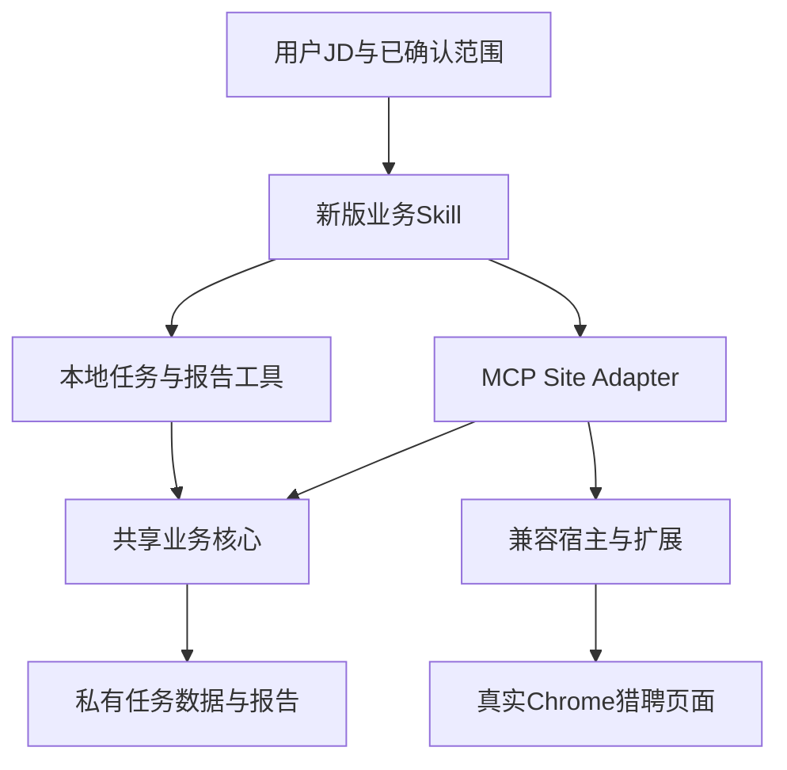

# 猎聘产品总入口

当前开发主线是 **MCP Site Adapter＋业务Skill＋兼容浏览器连接层**。旧CLI入口保留历史追溯，当前可用性未验证；不把它作为新版故障的自动回退方案。所有组件仍在同一个Git仓库，未拆仓。

## 从这里开始

| 要看什么 | 唯一入口 |
| --- | --- |
| 当前版本、安装宿主、测试和未验项 | [当前状态](STATUS.md) |
| MCP命令及参数 | [命令说明](../../docs/LIEPIN_MCP_COMMANDS.md) |
| 新版业务Skill原文 | [hunter-liepin-mcp](../../tools/liepin-mcp/skill/hunter-liepin-mcp/SKILL.md) |
| 安装、接入和回滚步骤 | [INSTALL](../../tools/liepin-mcp/INSTALL.md)（操作步骤；当前验收结论以本目录STATUS为准） |
| 产品需求 | [PRD](../../docs/prds/PRD-2026-Hunter-猎聘寻访能力.md)、[要求矩阵](../../docs/prds/LIEPIN_MCP_REQUIREMENTS_MATRIX.md) |
| 逐项完成审查 | [收口审查](../../docs/releases/LIEPIN_MCP_0.3.0_COMPLETION_AUDIT.md) |
| 目标助手与Windows后续验收 | [客户端验收卡](../../docs/releases/LIEPIN_MCP_CLIENT_ACCEPTANCE_CARD.md) |
| 来源与整理范围 | [来源清单](SOURCE.md) |

## 组件边界

| 组件 | 真实源码位置 | 职责 |
| --- | --- | --- |
| 新版Adapter | `tools/liepin-mcp/adapters/liepin/` | 13个标准浏览器业务命令 |
| 新版Skill | `tools/liepin-mcp/skill/hunter-liepin-mcp/` | 组织通用寻访流程；不硬编码单次客户任务 |
| 共享业务核心 | `distribution/liepin-search/runtime/packages/liepin/lib/` | 任务、证据评估、报告、授权与恢复；新版仍依赖它，不能按旧版代码删除 |
| MCP执行配套 | `tools/liepin-mcp/lib/`、`local.mjs` | Adapter适配与本地工具 |
| 扩展兼容构建 | `tools/liepin-mcp/build-extension.mjs`、`lib/compat-build.mjs` | 从固定官方扩展生成兼容副本、校验构建身份 |
| 宿主兼容与安装 | `tools/liepin-mcp/compat/`、`scripts/` | 同会话标签、宿主补丁、持久安装和通信配置 |
| 历史CLI与Skill | `distribution/liepin-search/runtime/packages/liepin/`的CLI入口、`distribution/liepin-search/skills/hunter-liepin-search/` | 历史来源，当前端到端未复验 |
| 网站介绍和分发 | `src/app/skills/liepin-search/`及发布脚本 | 独立于本地安装状态；本轮未改线上页面 |

仓库内`.agents/skills/hunter-liepin-mcp/`仅作导航桥接，完整Skill真源只有上表一份。安装包仍从既有构建入口生成，不改变运行路径。源码不包含已加载的临时扩展目录、node_modules或候选人资料。

后续单独重构再将共享核心抽到`packages/liepin-core/`；本轮没有搬目录，也未删除诊断资料或工作树。
